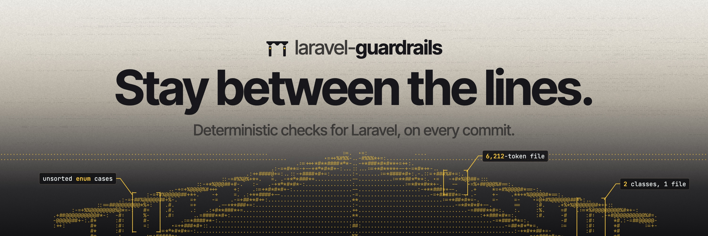

[](https://github.com/claudiodekker/laravel-guardrails/actions/workflows/ci.yml)
[](https://packagist.org/packages/claudiodekker/laravel-guardrails)

## About Laravel Guardrails

Laravel Guardrails runs deterministic checks over a Laravel repository. You list your rules in one file, `guardrails.php`, and a pre-commit hook runs them on the lines you changed. Only new code fails, so you can add the package to an existing app without fixing it first. Every failure names the file, the line and the fix, so a developer or an AI agent can act on it directly.

## Quick start

1. Install the package and choose your checks:

    ```bash
    composer require --dev claudiodekker/laravel-guardrails
    vendor/bin/guardrails install
    ```

    Pick one or more presets, or single checks. The command saves your choice to `guardrails.php`.

2. Commit as usual. The hook checks only the lines you changed, and refuses the commit when a check fails.

3. Narrow a check if you need to, with `->only(...)` or `->allowing([...])`. See [Configure a check](#configure-a-check).

4. Write a rule of your own as a small class, and add it to the same list. See [Write your own rule](#write-your-own-rule).

Composer asks whether to allow the plugin the first time. Answer yes, or add it to `allow-plugins` yourself:

```json
{
    "config": {
        "allow-plugins": {
            "claudiodekker/laravel-guardrails": true
        }
    }
}
```

## Choose the checks

`vendor/bin/guardrails install` lets you pick checks one by one or start from presets, and asks before it writes `guardrails.php`. Tick several presets to combine them, or pass `--preset` more than once. The package ships presets for apps, packages and Laravel's own style, and any installed package can add its own. `guardrails.php` stores the class names, not the preset's name, so a preset that grows later does not change what your app runs.

`vendor/bin/guardrails list` prints every check you can choose and every preset. Add `--details` to print what each check flags and the options it takes.

Without a terminal, such as in a script, pass the selection as flags. The command then asks nothing: it writes `guardrails.php` and installs the pre-commit hook.

```bash
vendor/bin/guardrails install --preset=essentials --preset=laravel --check='App\Guardrails\NoTableAccess'
```

The flags add to the checks `guardrails.php` already selects, and the command never removes or rewrites an entry it finds there, so a configured entry keeps its options, `only()`, `allowing()` and label. It prints the checks it added. To remove a check, turn it off in the picker or delete its entry from `guardrails.php`.

## Configure a check

`guardrails.php` returns the list of checks that run, in that order:

```php
<?php

use App\Guardrails\NoTableAccess;
use ClaudioDekker\LaravelGuardrails\Checks\Php\Safety\NoDebugCalls;
use ClaudioDekker\LaravelGuardrails\Checks\Php\Safety\NoEval;
use ClaudioDekker\LaravelGuardrails\Checks\Text\FilesWithinTokenBudget;

return [
    new FilesWithinTokenBudget(limit: 8000),
    (new NoEval)->only('packages/*/src'),
    (new NoDebugCalls)->allowing([
        'app/Console/Commands/Inspect.php' => 'It dumps the state on purpose.',
    ]),
    NoTableAccess::class,
];
```

A check you don't configure stays `::class`. To give a check options, create it with `new` and pass them by name. `only()` limits a check to paths from the project root, where a folder covers everything under it and `*` matches one folder name. `allowing()` skips files or folders for that one check, each with the reason it may break the rule. Both apply only to the check they are chained on, and `only()` never makes a check read code it doesn't already read.

`NoNamespaces` keeps code from using the namespaces you give it. List it once for each boundary, and label each entry with `->as()` so the report tells them apart:

```php
(new NoNamespaces(['Acme\Crm']))->only('packages/billing/src')->as('NoCrmInBilling'),
(new NoNamespaces(['Acme\Billing']))->only('packages/crm/src')->as('NoBillingInCrm'),
```

A PHP file that does not parse fails every run that checks it, whatever checks you selected. To keep files that are broken on purpose, allow them on `NoSyntaxErrors`:

```php
(new NoSyntaxErrors)->allowing([
    'tests/Fixtures/broken' => 'The parser tests read files that do not parse.',
]),
```

You can edit `guardrails.php` by hand. `guardrails install` keeps your configured entries and comments.

## Write your own rule

A rule of your own is a class in your app that extends `Check` and returns the violations of a file: the places that break the rule. If all you need is to forbid some calls, extend `ForbiddenCalls` and list them. Add the class to `guardrails.php` like any other check, as `NoTableAccess::class` above. Test it with `Testing\TestFile`, which runs the check over a file you write in the test, and over a change to it. [Write a check](docs/writing-checks.md) walks through one, [Test a check](docs/testing-checks.md) tests it, and [Publish a check pack](docs/check-packs.md) shows how to offer checks from a package.

## Run the checks

`vendor/bin/guardrails` runs in one of three modes, and refuses to combine them:

- `guardrails --staged` checks the changes you staged. The pre-commit hook runs this.
- `guardrails` checks the changes since the branch left the default branch, which it reads from `origin/HEAD`. Pass `--base=<ref>` to compare against another branch, such as `--base=origin/develop`. When the `--base` you pass does not exist or shares no history with HEAD, it prints why and fails.
- `guardrails --all` checks every file git tracks, old violations included. Run it by hand to clean up.

In the first two modes, a failure counts only when the change touches the lines it spans, so an app fresh from `laravel new` passes. [How a run works](docs/how-it-works.md) describes what counts as new, which files no check reads, how the command finds your source, tests, config and other kinds of code without any setting, and what the pre-commit hook does.

The command prints the failures on stderr, grouped per check, and exits with a non-zero code. Each entry of `guardrails.php` is grouped under its label:

```
NoEmDashes
  README.md:12 Replace the em dash with a comma, a colon, parentheses or a new sentence.
  app/Models/User.php:30 Replace the em dash with a comma, a colon, parentheses or a new sentence.
```

On success it prints one line on stdout that names what it checked: the staged changes, the range such as `origin/HEAD..HEAD`, or every tracked file. A run against a base reads commits only, so when the working tree or index holds changes it did not read, it says so on stderr. The wording of the text output is not a stable interface yet. `--help` prints the usage and `--version` the installed version.

Without `guardrails.php`, or with an empty list, a run on your machine passes and points at `guardrails install`. A listed class that does not exist fails the run. A check is never skipped silently.

The exit code tells a failed check from a broken setup:

| Code | Meaning |
| --- | --- |
| 0 | Every check passed. |
| 1 | A check found a violation, or an `allowing()` path matches no tracked file. |
| 2 | The run stopped, or a check crashed: a bad `guardrails.php`, an unknown or repeated option, a wrong argument to `install` or `list`, a `--base` that does not exist, a `composer.json` or `phpunit.xml` that does not parse in the revision being checked (one that does not parse in the base only makes the changed files count in full), a folder that is not a git repository, or an error in a check or in the command itself. |

## CI

Commit `guardrails.php`, then add `guardrails` to the script CI runs:

```json
{
    "scripts": {
        "test": [
            "pint --test",
            "pest",
            "guardrails --base=origin/main"
        ]
    }
}
```

CI needs the history back to where the branch started. On GitHub Actions, check out with `fetch-depth: 0`:

```yaml
- uses: actions/checkout@v7
  with:
    fetch-depth: 0
```

Pass the base branch as `--base`, as above. Without `--base`, a CI job that has no `origin/HEAD` fails with exit code 2 and a note on stderr, so a job never passes without checking anything. A missing `--base` ref fails the job in the same way, and so does a missing `guardrails.php` or an empty list, because a CI job that checks nothing must not pass. On a shallow clone, the note says to fetch the full history, and to pass `--base=origin/<branch>` or run `git remote set-head origin --auto`.

## Discovery and opting out

`guardrails install` and `guardrails list` offer the checks and presets that packages declare under `extra.guardrails.provides` in their `composer.json`, and the ones your app declares in its own. They read `vendor/composer/installed.json` and your `composer.json`, and never download anything or boot the app.

Discovery only offers a check. Nothing runs unless `guardrails.php` lists it, so a new package, or a preset that grows, never turns a check on. When two packages give a check the same short name, the picker shows each under its own package, and `guardrails.php` tells them apart by their full class names.

To ignore the checks and presets of a package, list it under `extra.guardrails.dont-discover`, or list `"*"` to ignore every package. Your app's own checks stay available:

```json
{
    "extra": {
        "guardrails": {
            "dont-discover": ["acme/guardrails-pack"]
        }
    }
}
```

## License

Laravel Guardrails is open-sourced software licensed under the [MIT license](LICENSE.md).
